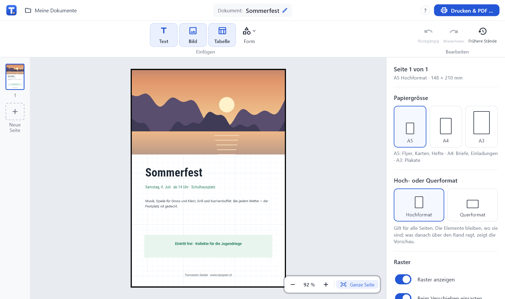

<p align="center"></p>

<h1 align="center">Textly</h1>

<p align="center"><b>Einladungen, Flyer, Briefe und Programme – ganz einfach, ohne Vorkenntnisse.</b><br>
Kostenlos · Windows 10 und 11 · Deine Dokumente bleiben auf deinem Computer</p>

<p align="center">
  <a href="https://github.com/Asu-Builds/Textly/releases/latest/download/Textly-Setup.exe"><b>⬇ Textly für Windows herunterladen</b></a>
  &nbsp;·&nbsp;
  <a href="https://asu-builds.github.io/Textly/"><b>📘 Anleitung lesen</b></a>
  &nbsp;·&nbsp;
  <a href="docs/kurzanleitung.pdf">Kurzanleitung (PDF)</a>
</p>

<p align="center"></p>

## In drei Schritten zur Einladung

1. **Vorlage wählen** – Einladung, Flyer, Brief, Programm oder ein leeres Blatt in A5, A4 oder A3.
2. **Text überschreiben** – hineinklicken und lostippen, Bilder mit einem Klick ersetzen.
3. **Drucken, PDF, E-Mail** – Textly prüft vorher, ob alles aufs Papier passt.

## Was Textly kann

- Mit Vorlagen beginnen oder mit einem leeren Blatt; eigene Dokumente als Vorlage aufbewahren
- Text, Bilder und Tabellen einfach auf die Seite setzen
- Speichert automatisch – frühere Stände lassen sich zurückholen, gelöschte Dokumente bleiben 30 Tage im Papierkorb
- Word- und PowerPoint-Dateien öffnen
- Kein Konto, kein Internet nötig

**Installieren:** Datei herunterladen und doppelklicken. Windows warnt bei neuen Programmen –
«Weitere Informationen» › «Trotzdem ausführen». [Schritt für Schritt mit Bildern](https://asu-builds.github.io/Textly/installieren.html)

**Fragen oder Fehler gefunden?** [Hier melden](https://github.com/Asu-Builds/Textly/issues) ·
[Häufige Fragen](https://asu-builds.github.io/Textly/fragen.html)

---

# Für Entwicklerinnen und Entwickler

Visueller Dokumenteneditor für kurze, professionell gestaltete Dokumente aus Text und Bildern.
Desktop-App mit Flutter (Windows, macOS).

## Aufbau

| Ordner | Inhalt |
|---|---|
| `packages/doc_model` | Dokumentmodell (reines Dart): Elemente, Seiten, Dokument, Verlauf, Griff-Geometrie. Unveränderlich. |
| `packages/doc_render` | Seitendarstellung und PDF-Export mit gemeinsamem Textsatz (PDF = Bildschirm). |
| `packages/doc_exchange` | Austausch mit PowerPoint (PPTX): Export und Import. Ergebnisse: `packages/doc_exchange/README.md`. |
| `app` | Die Desktop-App: Editor, Arbeitsfläche, Rechtschreibprüfung. |
| `spike` | Machbarkeitstest (abgeschlossen, nur noch Referenz). Ergebnisse: `spike/ERGEBNISSE.md`. |

Die drei Pakete bilden einen Dart-Workspace (`pubspec.yaml` im Wurzelordner).

## Starten und testen

```
flutter pub get
cd app && flutter run -d windows
```

```
cd packages/doc_model && dart test
cd packages/doc_render && flutter test
cd app && flutter test
```

## Installer (Windows)

```
cd app
powershell -ExecutionPolicy Bypass -File tool\build_installer.ps1
```

Ergebnis: `app/build/installer/Textly-Setup-<Version>.exe` (Version aus `app/pubspec.yaml`).
Daneben entsteht `Textly-Setup.exe` (gleicher Inhalt, fester Name): Beim GitHub-Release beide Dateien
hochladen – der Download-Link `…/releases/latest/download/Textly-Setup.exe` zeigt dann immer auf die neueste Version.
Braucht Inno Setup 6 (`winget install JRSoftware.InnoSetup`). Der Installer
- installiert ohne Administratorrechte (auf Wunsch für alle Benutzer),
- legt einen Startmenü-Eintrag an, auf Wunsch eine Desktop-Verknüpfung,
- verknüpft `.textly`-Dateien mit Textly (Doppelklick öffnet sie),
- bringt die Microsoft-C++-Laufzeit mit, damit Textly auf jedem Windows 10/11 (64 Bit) startet.

Der Installer ist nicht signiert: Windows SmartScreen fragt beim ersten Start nach
(«Weitere Informationen» › «Trotzdem ausführen»). App-Icon neu erzeugen: `python tool/make_icon.py`.

## Stand: Grundgerüst

- Dokumentmodell unveränderlich; Rückgängig/Wiederholen für jede Aktion (Verlauf aus Dokumentständen,
  Pfeiltasten werden zu einem Schritt zusammengefasst, Gesten und Textbearbeitung sind je ein Schritt).
- Auswählen, Verschieben (Bilder und Formen direkt, Text am Griff «Verschieben»).
- Griffe: Bild – runde Ecken = Grösse mit Seitenverhältnis, längliche Seiten = Form;
  Text – links/rechts = Breite (die Höhe folgt immer dem Text); Rechteck frei; Linie an den Endpunkten (rastet gerade ein).
- Text: erster Klick wählt, zweiter Klick setzt den Cursor an die Klickstelle; leerer Block wird entfernt.
- Tastatur: Entf, Strg+Z/Y, Strg+D, Pfeile (1 mm, mit Umschalt 5 mm), Esc, Eingabetaste.
- Seiten hinzufügen, umordnen, löschen; Miniaturen.
- A4 hoch oder quer für das ganze Dokument (rechte Leiste ohne Auswahl); auch im PDF und in PowerPoint
  (breite Folien werden beim Öffnen zu A4 quer).
- Text, Linie und Rechteck hinzufügen; Sperren, nach vorne/hinten, duplizieren, löschen.
- PDF erzeugen und drucken; Rechtschreibprüfung über den Windows-Dienst.
- Bilder einfügen (Knopf, Ziehen aus dem Explorer, Strg+V), Bildausschnitt, Eigenschaftenleiste,
  drehen in 90°-Schritten (Strg+R / Strg+Umschalt+R; auch im PDF und in PowerPoint).
- Einrasten, Ausrichtungslinien, Raster, Markierung von Überlappungen.
- Formatierung einzelner Wörter (fett, kursiv, unterstrichen, Farbe).
- Sieben Schriftarten (Roboto, Roboto Condensed, Montserrat, Nunito, Lora, Playfair Display, Caveat;
  OFL, siehe app/assets/fonts/LIZENZEN.md); ohne Wahl gilt die Schrift der Textart.
- Bedienoberfläche nach den Mockups: Werkzeugleiste «Beschriftete Gruppen», Eigenschaften «Sichtbare Vorlagen».
- «Meine Dokumente» (Startseite): alle Dokumente mit Vorschau, Suche, «Als Kopie verwenden», Umbenennen,
  Papierkorb (30 Tage). Speichern geschieht automatisch (rund 1 s nach jeder Änderung, sofort beim
  Verlassen); Ablage sichtbar unter `Dokumente\Textly` (eine .textly-Datei je Dokument + `bibliothek.json`).
  «Datei öffnen» bzw. Doppelklick holt .textly/.pptx/.docx als Kopie herein.
  Word (.docx): Titel, Untertitel, Überschriften, Fliesstext und Beschriftungen werden als Textblöcke der
  Reihe nach auf A4-Seiten gesetzt (aufeinanderfolgende Absätze gleicher Art in einem Block, volle Seiten gehen
  auf der nächsten weiter); fett/kursiv/unterstrichen/Farbe, Ausrichtung, nächstliegende Schrift, Listen
  («•», «1.», «a)»), Seitenumbrüche und Querformat werden übernommen, Änderungen nachverfolgen als
  angenommener Stand. Bilder (JPEG, PNG) in Word-Grösse (höchstens Satzspiegelbreite, Ausrichtung des
  Absatzes); Tabellen als Tabellen-Element mit Spaltenbreiten, Ausrichtung, Kopfzeile (Wiederholung, fett
  oder farbig hinterlegt), Linien und Linienfarbe aus Word, Schriftgrösse; lange Tabellen gehen auf der
  nächsten Seite weiter (Kopfzeile wiederholt); verbundene Zellen werden getrennt. Kopf- und Fusszeilen
  (auch eigene erste Seite, mit Bildern) stehen auf jeder Seite als gewöhnliche Blöcke, Seitenzahlen
  («Seite 2 von 5») eingesetzt; Fussnoten als «[1]» im Text und am Ende des Dokuments; Textfelder als
  gewöhnlicher Text; verborgener Text fällt weg, «Grossbuchstaben» werden übernommen. Nicht übernommen:
  Bilder in anderen Formaten (z. B. EMF), Kommentare – ein Hinweis nennt, was vereinfacht wurde.
  Alte .doc-Dateien: Meldung «als .docx speichern».
- Editor: Kopfzeile = ganzes Dokument: links «Meine Dokumente», mittig «Dokument: Name ✎» (Klick ändert
  den Namen; leer folgt er wieder dem ersten Text), rechts «?» und «Drucken, PDF, E-Mail …». Speichern
  geschieht still; nur wenn es nicht klappt, erscheint ein Hinweis.
  Befehlszeile: «Einfügen» mittig über der Seite (Text, Bild, Tabelle hervorgehoben; «Form» mit Fläche
  und Linie), rechts «Bearbeiten» (Rückgängig, Wiederholen, «Frühere Stände» = Zeitstrahl ein/aus).
  Zoom und «Ganze Seite» unten rechts an der Arbeitsfläche (immer sichtbar); Raster (Anzeigen, Einrasten,
  Rasterweite) in den Eigenschaften der Seite, wenn nichts ausgewählt ist.
- Arbeiten am Element: ein Klick in Text oder Tabellenzelle setzt den Cursor; beim Schreiben schwebt eine
  Textleiste über dem Text (Schriftart, Grösse, F/K/U, Farbe, Ausrichtung, Textblock löschen); ausgewählte
  Bilder, Formen, Linien und Tabellen haben eine Leiste mit nur dem Nötigen: Löschen, Drehen (Bilder) und
  «Nach vorne holen»/«Nach hinten legen» nur bei Überdeckung. Keine Fusszeile, kein Sperren (gesperrte
  Elemente aus älteren Dateien: «Entsperren»). Farben: Palette plus «+» für beliebige Farben (Farbfeld,
  Farbton, Farbcode, zuletzt gewählte). Neue Elemente
  erscheinen unter dem zuletzt bearbeiteten, nie überdeckend, und die Ansicht scrollt dorthin.
- Leere Seite: Startknöpfe Titel, Text, Bild, Tabelle; bei nur einer Seite schmale Seitenübersicht.
- Neu beginnen (Startseite): «Leeres Blatt» mit Wahl A5 · A4 · A3 und hoch · quer direkt auf der Kachel,
  dahinter eigene Vorlagen (★ Eigene) und mitgelieferte (Einladung, Flyer A5, Brief mit Briefkopf,
  Jahresprogramm, Protokoll, Plakat A3), Filter nach Art. Ein Klick legt ein neues Dokument als Kopie an.
  Eigene Vorlagen: im Menü «…» eines Dokuments oder im Bildschirm «Drucken, PDF, E-Mail …» «Als Vorlage
  speichern» (Name, Art); Seite «Vorlagen» in der Seitenleiste zum Bearbeiten, Umbenennen, Löschen.
- Papiergrösse A5 · A4 · A3 in den Eigenschaften der Seite; beim Umstellen wird alles mitskaliert (Lage,
  Grösse, Schrift, Linien), Meldung mit «Rückgängig». PDF und PowerPoint in der gewählten Grösse; Word- und
  PowerPoint-Dateien in A5/A3 behalten ihr Format.
- «Fertigstellen»: zuerst prüfen (Seiten wie gedruckt, Hinweise auf Probleme), dann wählen – Drucken,
  als PDF speichern, per E-Mail senden (PDF bereitlegen), als Datei weitergeben, PowerPoint.
- Frühere Stände (Knopf bei Rückgängig): blendet unter dem Editor einen Zeitstrahl ein;
  der Editor bleibt, wie er ist. Gemerkt werden nur Sicherungspunkte, jeweils der Stand danach: Löschungen
  («Titel wurde gelöscht», mehrere innert 60 s zusammen), grosse Veränderungen («Bild wurde verschoben»),
  Arbeitsabschnitte nach 5 Minuten Pause bzw. beim Verlassen («Bearbeitet: 3 Texte, 1 Bild»), Weitergaben
  und benannte Stände. Oben die Tage als Knöpfe (die letzten vier, ältere unter «Älter ▾»), darunter nur die
  Stände des gewählten Tages mit Uhrzeit; lange Pausen werden verkürzt gezeigt. ‹ › und Pfeiltasten gehen
  über Tagesgrenzen. Piktogramme zeigen, was betroffen ist und was geschah. Ein Klick auf einen Punkt zeigt
  den Stand in der Arbeitsfläche (gelber Hinweis «nur zum Ansehen», Gelöschtes gestrichelt). Darunter zwei
  Knöpfe: «Zurück zu meinem aktuellen Dokument» (auch Esc) und «Mit diesem Stand weiterarbeiten» (macht ihn
  zum neuesten, Strg+Z macht es ungeschehen). Bei «Jetzt»: «Zeitstrahl schliessen». Automatisch gespeichert
  wird nur bei geändertem Inhalt.
  Gespeichert unter `%LOCALAPPDATA%\Textly\Verlauf` (nie in weitergegebenen Dateien), 30 Tage aufbewahrt,
  benannte Stände für immer.
- Tabelle («Einfügen» → «Tabelle»: Anzahl Spalten direkt wählen, Zeilen und Überschrift vorbelegt): wird wie
  ein Textblock am Griff verschoben, Klick in eine Zelle zum Schreiben, Tab in die nächste Zelle. An der
  aktuellen Zelle stehen «+ Spalte» (rechter Rand) und «+ Zeile» (unter der Zelle), am Tabellenrand
  «Zeile löschen» (auf Höhe der Zeile) und «Spalte löschen» (über der Spalte) – beim Schreiben und Auswählen
  gleich, mit Vorschau beim Zeigen; Rechtsklick zusätzlich «Zeile darüber», «Spalte links». Innere senkrechte
  Linien lassen sich ziehen. Vorlagen «Kopfzeile farbig» und «Gitter»; Schrift, Grösse, Ausrichtung je Spalte, Linien
  (alle, waagrecht, aussen, keine; Farbe, Stärke), Farbe der Kopfzeile, gestreifte Zeilen. Zellen werden wie
  Textblöcke gesetzt (gleich in Anzeige, Eingabe und PDF); PowerPoint: echte Tabelle (a:tbl), hin und zurück.
- Speichern/Öffnen als `.textly` (ZIP mit `document.json` und Bildern), Neu, Speichern unter,
  Rückfrage bei ungespeicherten Änderungen (auch beim Schliessen), Wiederherstellung nach Absturz.
- PowerPoint öffnen und exportieren (Menü «Datei»).
- Vorschau vor dem Drucken mit Hinweisen: abgeschnittene Elemente, zu nah am Papierrand (5 mm),
  unscharfe Bilder (unter 150 dpi). Klick auf einen Hinweis wählt das Element im Editor.

## Nächste Schritte

1. Schriften in PPTX einbetten; Test in PowerPoint
2. win32/desktop_drop aktualisieren (mit Handtest)

## Technische Vorgaben

Die Regeln für deckungsgleiche PDF-Ausgabe (Kerning, gemessene Grundlinie, identische Konfiguration
von Anzeige und Eingabefeld) stehen in `spike/ERGEBNISSE.md` und in `packages/doc_render/lib/src/text_layout.dart`.
Sie dürfen nur mit erneuter Messung geändert werden.

## Anleitung (Website und Kurzanleitung)

Die Anleitung liegt in `docs/` und wird über GitHub Pages veröffentlicht (Einstellungen › Pages ›
Branch `main`, Ordner `/docs`). Einfache HTML-Seiten ohne Build-Schritt; `docs/site.js` enthält Kopf,
Fuss, Navigation und die Adressen (GitHub-Konto, Version).

- Bildschirmfotos neu erzeugen (nach Änderungen an der Oberfläche):
  `cd app && flutter test tool/docs_screenshots_test.dart` – schreibt `docs/bilder/*.png` und
  `docs/bilder/marken.js` (Lage der Knöpfe für die nummerierten Markierungen).
- Kurzanleitung neu erzeugen: `cd app && flutter test tool/kurzanleitung_test.dart` – setzt
  `docs/kurzanleitung.pdf` mit Textly selbst.
- Lokal ansehen: `python -m http.server 8765 --directory docs`, dann http://localhost:8765.
- Adresse der Anleitung in der App: `app/lib/links.dart`.
